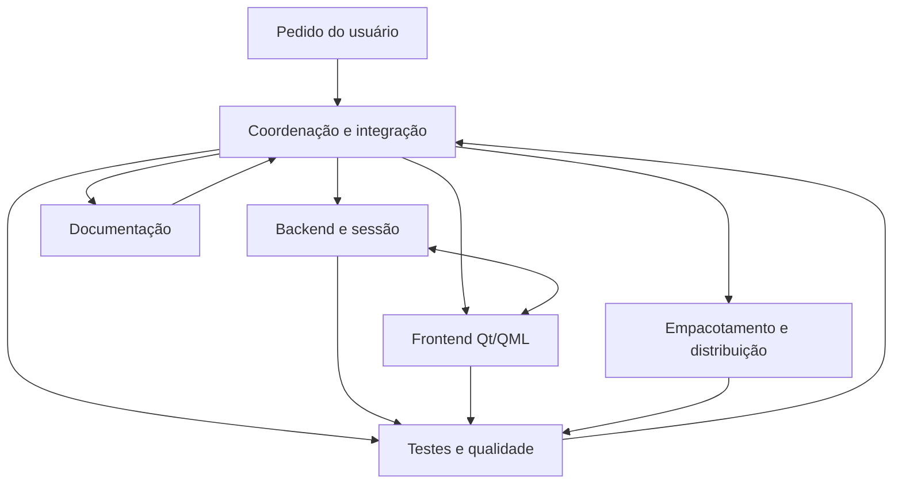

# Arquitetura de agentes de IA do CouchPad

Esta arquitetura organiza responsabilidades para tarefas do projeto. Cada
papel pode ser assumido pelo agente principal ou delegado quando a plataforma e
as instruções da sessão permitirem. Estes documentos não criam serviços,
subagentes permanentes nem configuram delegação automática.

## Coordenação e integração

- Interpreta o pedido, identifica áreas e contratos afetados, divide tarefas
  independentes quando houver delegação disponível e define limites de edição.
- Revisa alterações conjuntas, resolve conflitos, executa a validação pertinente
  e apresenta resultados e lacunas. Uma pessoa/agente fica responsável pela
  integração final mesmo quando outras áreas são delegadas.
- Para tarefas pequenas, pode assumir diretamente outros papéis.

## Backend e sessão

- Cuida de `session.py`, `displays.py`, `audio.py`, `gamepad.py`, `discovery.py`,
  `cli.py`, `config.py`, `control.py`, `notifications.py` e `system.py`.
- Mantém a máquina de estados, descoberta, IPC, persistência, troca e recuperação;
  preserva compatibilidade e identifica efeitos sobre a interface e os pacotes.
- Ao alterar comandos ou estados IPC, informa o frontend e acrescenta cobertura
  para erros, cancelamento e restauração quando pertinentes.

## Frontend Qt/QML

- Cuida de `qt_frontend.py`, `qml/`, dos assets e do comportamento de janela,
  bandeja, acessibilidade e autosave. A interface GTK histórica fica em `tray.py`.
- Consome o contrato do daemon, mantém a interface responsiva durante operações
  longas e apresenta erros e estado confirmado de forma compreensível.
- Valida a interface Qt com `tests/test_qt_frontend.py` e a aplicação empacotada;
  distingue verificação automatizada de confirmação visual. A skill de projeto
  `skills/couchpad-frontend/SKILL.md` contém orientações específicas.

## Testes e qualidade

- Cuida de `tests/` e dos roteiros de validação pertinentes em `tools/`.
- Cobre comportamento observável e regressões relevantes, sobretudo restauração,
  concorrência, persistência, IPC e falhas de comandos externos.
- Executa a suíte principal e, quando aplicável, verifica GTK, pacote ou hardware.
  Registra ambiente, comando, resultado e limitações; não confunde mocks ou
  contêineres com validação física de outros desktops.

## Empacotamento e distribuição

- Cuida de `packaging/`, `portable.py` e dos roteiros de build/runtime em `tools/`.
- Preserva primeiro uso desativado, supervisão do monitor e recuperação; verifica
  dependências do host e artefatos junto aos seus manifestos e hashes.
- Valida o AppImage construído na base Debian 12 e o limite de glibc 2.36.
  Documenta que o Flatpak atual usa `flatpak-spawn --host` e não isola o backend.
- Não publica releases, modifica instalações de terceiros ou anuncia novos
  sistemas suportados sem instrução e evidência adequadas.

## Documentação

- Mantém `README.md`, `docs/` e manuais de embalagem alinhados ao código e aos
  resultados verificados. Relatórios datados continuam identificados como históricos.
- Registra requisitos, comandos e limitações de forma reproduzível, sem expor
  dados pessoais e sem transformar planos em funcionalidades implementadas.

## Fluxo entre papéis

1. A coordenação descreve objetivo, arquivos, contratos e critérios de aceite.
2. Cada responsável examina o contexto e comunica mudanças que afetem outra área.
3. Backend e frontend combinam alterações em configurações e protocolo antes
   da integração; empacotamento verifica mudanças em dependências e processos.
4. Qualidade valida o resultado integrado e informa riscos ou testes não executados.
5. Documentação atualiza instruções e evidências; coordenação entrega o resultado.

Ao delegar, informe escopo, arquivos esperados, restrições e validação requerida;
evite edições simultâneas no mesmo arquivo. Não compartilhe segredos ou dados
pessoais que não sejam necessários à tarefa.
