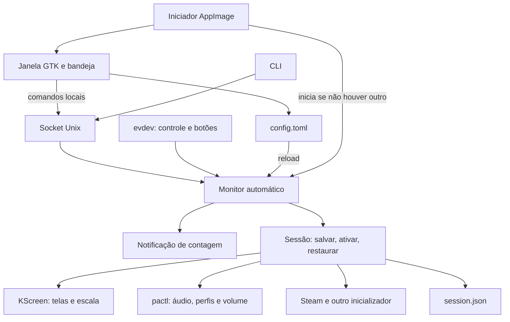

# Arquitetura técnica

[Índice da documentação](README.md)

## Visão atual

O aplicativo é Python 3.11+; a beta local foi congelada com o Python 3.14 do
host de build. A interface usa GTK 3 por PyGObject. A integração de telas é
específica de KScreen; a janela força `GDK_BACKEND=x11` e usa XWayland na sessão
Wayland testada. Ainda não existe uma seleção abstrata de adaptadores.

## Mapa do código

| Arquivo | Responsabilidade |
|---|---|
| `shiftpad_linux/__main__.py` | Entrada `python -m shiftpad_linux` |
| `cli.py` | CLI, loop do monitor e máquina de estados |
| `tray.py` | Janela, bandeja, autosave, workers e apresentação da descoberta |
| `config.py` | Dataclass `Config`, validação TOML e persistência de preferências |
| `control.py` | Socket Unix, comandos permitidos e respostas JSON |
| `gamepad.py` | Enumeração evdev, filtro de identidade e leitura de botões |
| `discovery.py` | EDID, fabricantes, áudio, controles e confiança da associação |
| `displays.py` | Snapshot KScreen, planos de troca/restauração, escala e HDR |
| `audio.py` | Sinks, modelo HDMI, perfis, saída padrão e volumes por canal |
| `session.py` | Registro persistente, ativação, restauração e identidade de processos |
| `notifications.py` | Contagem, substituição e fechamento da notificação |
| `portable.py` | Primeiro uso e supervisão do monitor na beta AppImage |
| `system.py` | Execução de ferramentas, erros e limpeza de ambiente dos subprocessos |
| `assets/` dentro do pacote | Marca e sete SVGs de cartões; oito SVGs no runtime-check |
| `systemd/` | Unidades opcionais, independentes da supervisão do AppImage |
| `packaging/appimage/` | Entrada congelada, AppRun, desktop file, spec, hook e manual |
| `tools/` | Build e roteiros de verificação |
| `tests/` | Suíte automatizada |

## Processos e propriedade

No modo com serviços há um processo de monitor e outro de interface. A janela
não lê o controle para automatizar uma sessão por conta própria; envia comandos
ao monitor. Fechar essa interface não encerra o serviço independente.

No modo AppImage sem argumentos, `portable.main()`:

1. Verifica a presença de `kscreen-doctor` e `pactl`.
2. Gera a configuração inicial somente se não existir.
3. Consulta o socket e reutiliza o monitor que responder.
4. Se necessário, inicia um filho `couchpad run` usando o executável congelado.
5. Aguarda a disponibilidade do socket antes de abrir a interface.
6. Ao sair, envia SIGTERM somente ao filho que possui e aguarda a restauração.

O AppImage não instala unidades systemd nem atalhos automaticamente. O reuso
atual depende da resposta ao protocolo, não de uma negociação de versão do
servidor. Um serviço já aberto pode executar código diferente do binário da
interface; versionamento/negociação do IPC é uma melhoria futura.

`SIGTERM`/`SIGINT` no iniciador são encaminhados para encerrar o loop GTK. O
monitor trata os sinais e restaura uma sessão pendente no bloco `finally`.
No encerramento do filho, o iniciador aguarda até 60 s e, se necessário,
continua aguardando, em vez de usar SIGKILL durante uma restauração.

## Máquina de estados

O monitor usa booleanos e prazos, não uma classe de estados formal. Os principais
campos são `active`, `manual_active`, `armed`, `blocked`, `wake_on_input`,
`input_started_session`, `connect_at`, `disconnect_at` e `connected_before`.

| Situação | Comportamento principal |
|---|---|
| Automação desativada | Sem disparo automático; controle livre no desktop |
| Controle já presente no início/reativação | Aguarda botão para iniciar |
| Nova conexão sem combinação | Arma a contagem, se a automação estiver ativa |
| Botões de ativação reconhecidos | Arma/rearma conforme bloqueio e estado |
| Contagem | Atualiza uma notificação; cancelamento limpa o prazo e bloqueia a tentativa |
| TV ativa automaticamente | Desconexão observada agenda restauração |
| TV ativa manualmente sem controle | Não depende de desconexão de controle para continuar |
| Reconexão durante atraso de restauração | Cancela o prazo de desconexão |
| TV fisicamente desconectada | Tenta restaurar o desktop e bloqueia a tentativa corrente |
| Falha de ativação | Cancela a contagem e aguarda nova condição de acionamento |

`Watcher.poll()` espera normalmente até 0,25 s, procura dispositivos a cada
aproximadamente 1 s e acompanha um dispositivo compatível por vez. A verificação
da conexão da TV durante a sessão ocorre aproximadamente a cada 3 s.
Tempos reais incluem comandos externos e agendamento do sistema.

## Descoberta e identidades

### Monitores

`kscreen-doctor -j` fornece a topologia. O EDID é lido em
`/sys/class/drm/*-<conector>/edid`; são extraídos fabricante, modelo, produto e
SHA-256. A tabela PNP é consultada em `/usr/share/hwdata/pnp.ids`, quando existe.
Falhas nessa tabela não impedem apresentar o código bruto do fabricante.

O hash identifica o painel configurado; `DP-2`/`HDMI-A-3` são endereços locais.
A descoberta não muda a tela. Antes da ativação, o plano exige os dois monitores
conectados, desktop ativo e EDID compatível quando configurado.

### Controles

A identificação combina nome, vendor/product IDs e `uniq` opcional. O caminho
evdev é usado para abrir o dispositivo, não como única identidade persistente.
A detecção considera capacidades de gamepad e descarta dispositivos inacessíveis.
Ausência de permissão pode resultar em lista vazia, não em ausência física.

### Áudio

As saídas são obtidas de `pactl list sinks`; metadados incluem descrição,
`alsa.name`/`node.nick` e porta ativa. A escolha considera:

1. Sink explicitamente configurado, se presente.
2. Correspondência única com o modelo da TV.
3. Uma única saída HDMI nova, diferente da original.
4. Ativação de perfil estéreo de uma porta HDMI disponível, com modelo exato e
   único, para expor o sink que faltava.

O algoritmo aguarda normalmente até 10 s. Não escolhe arbitrariamente entre
múltiplas correspondências. Em algumas falhas registra aviso e mantém o áudio.
Os perfis são consultados por `pactl -f json list cards`; a preferência por
estéreo evita escolher surround sem uma solicitação específica.

## Persistência

| Dado | Caminho padrão |
|---|---|
| Preferências | `~/.config/shiftpad-linux/config.toml` |
| Estado recuperável | `~/.local/state/shiftpad-linux/session.json` |
| Lock do monitor | `session.lock`, ao lado do estado |
| Socket de controle | `$XDG_RUNTIME_DIR/shiftpad-linux.sock` |

Os caminhos respeitam `XDG_CONFIG_HOME`, `XDG_STATE_HOME` e `XDG_RUNTIME_DIR`.
O fallback do runtime é `/run/user/<uid>`. Esses nomes históricos são parte da
compatibilidade da instalação atual.

As atualizações regulares do TOML e do estado usam arquivo temporário,
permissões 0600, `flush`, `fsync` e substituição com `os.replace`. O writer do
TOML preserva os demais campos/comentários na medida do formato suportado e
atualiza apenas as chaves pertinentes. A configuração inicial do AppImage usa
criação exclusiva para não sobrescrever um arquivo já criado por outro processo.

O lock usa `fcntl.flock` para impedir dois monitores sobre o mesmo caminho de
estado. Separar os diretórios XDG também separa lock/estado: os testes fizeram
isso mantendo as automações desativadas, não para controlar o mesmo hardware
simultaneamente.

## Transação de uma sessão

Antes da alteração, `Session.activate()` captura a topologia, saída padrão,
sinks, perfis e volumes disponíveis. O registro inclui também desktop/TV,
modo, sink escolhido, comandos de saída, início de launcher e identidade do
processo próprio. Os dados são gravados antes das mutações correspondentes.

A ativação aplica a topologia, verifica TV habilitada e, em `tv-only`, desktop
desativado, reaplica propriedades HDR conhecidas, escolhe áudio, salva o volume
da TV caso o sink só tenha surgido depois e define 100%. Em seguida executa
comandos CEC e inicializadores habilitados.

Na restauração:

1. Recupera os volumes enquanto a saída HDMI ainda existe.
2. Aplica a topologia anterior, reativando o desktop e ignorando destinos
   desconectados.
3. Confere o estado habilitado/desabilitado das saídas conectadas e tenta
   recuperar HDR/WCG/brilho conhecidos.
4. Restaura perfis, reaplica volumes novamente nas saídas que voltaram e define
   a saída padrão anterior.
5. Executa comandos de saída e sinaliza apenas o launcher próprio identificado.
6. Remove o registro após completar o caminho principal.

Uma falha estrutural de restauração conserva o registro para nova tentativa.
Algumas falhas de áudio, HDR e comandos auxiliares são apenas avisos e não
impedem a remoção final do registro. A recuperação não verifica todas as
propriedades e não garante som audível ou sucesso de comandos externos;
melhorar a recuperação parcial é uma pendência explícita.

Ao iniciar o monitor com registro pendente, ele tenta restaurar antes de
acompanhar uma nova sessão. A validação de volume, perfis e escala é local ao
backend Linux; um futuro backend precisa de representação equivalente.

## IPC e interface

O socket aceita `status`, `activate`, `restore`, `reload`, `enable`, `disable` e
`cancel`. O protocolo recebe uma linha de texto e responde JSON com `ok` e
campos de estado ou `error`. O socket tem permissões 0600; o controle de acesso
atual vem dessas permissões do filesystem, sem autenticação de rede adicional.
Não é um servidor TCP exposto.

`status` informa `active`, `enabled`, `manual`, `controller`, `mode`,
`awaiting_input`, `awaiting_reconnect` e `countdown_pending`. O cliente limita a
leitura a aproximadamente 8 KiB; o servidor lê comandos pequenos e aceita uma
lista fechada de nomes.

O servidor processa operações sequencialmente. A interface usa workers para
salvar/enviar ações e `GLib.idle_add` para voltar ao GTK. Durante uma ação local
usa o último estado confirmado, evitando consultas concorrentes ao daemon
ocupado. A varredura periódica é suspensa enquanto `busy`. Isso não constitui
uma implementação inteiramente assíncrona do protocolo: consultas de outro
cliente durante uma operação longa ainda exigem cuidado com timeouts.

Atualização de estado da janela: cerca de 2 s. Varredura periódica: cerca de
10 s, além da detecção explícita. Autosave: tipicamente 100 ms nos interruptores,
550 ms nos outros ajustes e reavaliação em 250 ms se estiver ocupado. Ações de
ativar/restaurar usam timeout de 45 s no cliente da janela.

## Execução de programas e ambiente congelado

Comandos são listas de argumentos; não há `shell=True`. Argumentos de outro
launcher passam por `shlex.split`, e `.desktop` usa `gio launch`.

O fechamento próprio usa PID + boot ID + instante de criação em `/proc`,
revalida a identidade e envia SIGTERM somente ao processo correspondente.
Não é feita uma operação genérica de encerrar todos os processos pelo nome.

PyInstaller altera caminhos de bibliotecas. `host_environment()` restaura ou
remove `LD_LIBRARY_PATH`, filtra caminhos internos e remove configurações
privadas de loaders antes de iniciar ferramentas do host e inicializadores.
O filho que executa o próprio monitor congelado mantém o ambiente do bundle.

O hook do AppImage reloca configurações Glycin para um diretório temporário e
aponta para os auxiliares incluídos. **Há uma limitação confirmada:** o sandbox
do auxiliar SVG usa bibliotecas do sistema, mesmo havendo cópias no bundle.
Apenas copiar as bibliotecas não resolveu o Arch limpo; ver [Build e testes](build-testes.md).

## Acoplamentos a remover para outras plataformas

O código ainda depende de KScreen, pactl, evdev, `/sys`, `/proc`, `fcntl`, sinais
Unix, diretórios XDG, socket Unix e comandos externos Linux. O formato do
snapshot é o JSON do KScreen, não um modelo de telas universal. `tray.py` mistura
apresentação e integração. Extrair adaptadores e um modelo neutro deve preceder
promessas de compatibilidade com outros desktops ou Windows.
