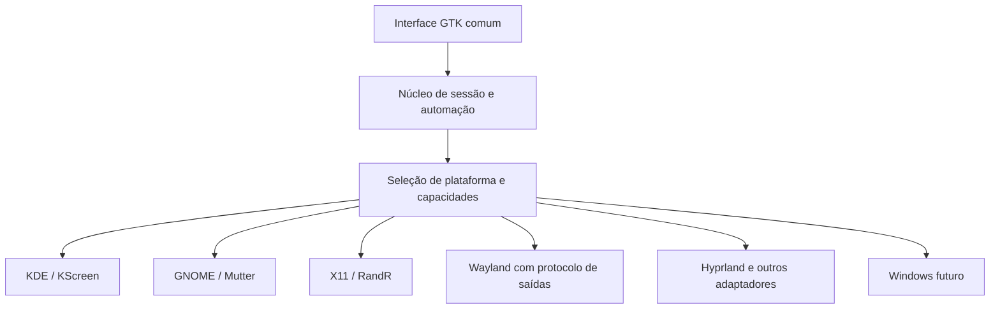

# Planos futuros e critérios de conclusão

[Índice da documentação](README.md)

Este documento registra intenções do usuário e propostas técnicas discutidas.
Não é um conjunto de funcionalidades já disponíveis nem uma promessa de prazo.
A decisão de produto é **manter GTK** e evoluir uma base comum do CouchPad.

## Direções acordadas

- Ampliar o alcance para famílias Arch, Debian, Fedora e outros Linux.
- Ampliar o suporte a ambientes gráficos além do KDE Plasma.
- Distribuir o aplicativo de forma simples, começando pelo AppImage beta.
- Preservar controle manual, autosave e recuperação do desktop.
- Manter a opção de jogar no monitor sem a automação.
- Fechar somente o inicializador próprio, preservando os jogos.
- Considerar Windows futuramente, aproveitando interface e núcleo.

A meta de “todas as distros e DEs” deve ser traduzida numa matriz explícita.
Há diferenças de arquitetura, libc, sessão, compositor, driver, escala e
permissões que um único arquivo de interface não elimina.

## Etapa A — corrigir a portabilidade do pacote

Atualização de 06/11/2026: base Debian 12/glibc 2.36 implementada, runtime
aprovado em seis userlands limpos e bundle Flatpak local criado. Veja
[o relatório](reconstrucao-2026-11-06.md). A publicação, auditoria completa
de dependências e certificação de outras sessões gráficas continuam pendentes.

Prioridade imediata antes de anunciar distribuição ampla:

| Entrega | Critério de aceite |
|---|---|
| Base de build com glibc mais antiga | Rodar o mesmo artefato nos userlands definidos, sem GLIBC ausente |
| SVG/fontconfig independentes de bibliotecas ocultas do host | Runtime-check e janela passam em ambiente limpo, sem instalar librsvg/fontconfig só para salvar o teste |
| Manifesto e rastreabilidade | Versão, arquitetura, glibc mínima observada, ferramentas e hashes associados ao binário |
| Primeiro uso portátil | Detectar candidatos, iniciar desativado, preservar configuração existente e apresentar erros úteis |
| Teste de integração do pacote | Monitor próprio/reutilizado, encerramento, estado pendente e ausência de duplicação exercitados |
| Preparação para publicação | Licença MIT já definida em `LICENSE`, recebida do repositório GitHub; revisar avisos e licenças das dependências e assets antes da distribuição |

Não atualizar a glibc do usuário como solução de distribuição. A correção é
construir o produto para a base escolhida. glibc antiga, sozinha, também não
resolve CPU/ABI, bibliotecas gráficas, toolkits auxiliares ou drivers.

## Etapa B — separar núcleo e integrações Linux

A arquitetura proposta é:

Passos de refatoração, ainda não realizados:

1. Definir contratos de descoberta, captura, planejamento, aplicação e
   restauração de telas; contratos semelhantes para áudio e controles.
2. Criar um snapshot neutro, com IDs estáveis, capacidades e propriedades
   suportadas. Hoje o estado persistido contém JSON KScreen.
3. Mover a implementação existente para o adaptador KDE sem alterar o fluxo
   funcional e manter os testes de regressão.
4. Separar regras de sessão da UI, inclusive o reconhecimento de comandos
   Steam e a persistência ligada diretamente aos widgets.
5. Selecionar adaptadores por capacidades verificadas e APIs disponíveis,
   usando variáveis de sessão como pistas, não como única prova.
6. Versionar configuração/registro/IPC e tratar migração ou restauração de
   registros anteriores antes de mudar o formato.

Uma interface possível de backend teria operações como `discover`, `capture`,
`validate`, `activate`, `restore` e `capabilities`. Esses nomes são proposta,
não classes ou métodos públicos já existentes no projeto.

### Adaptadores de tela propostos

| Ambiente | Integração candidata | Observações |
|---|---|---|
| KDE/Wayland | KScreen existente | Primeira etapa é encapsular e preservar |
| GNOME/Wayland | D-Bus `org.gnome.Mutter.DisplayConfig` | Validar versões, seriais, modos e escalas suportadas |
| X11: Xfce, MATE e outros | RandR | Transformação de saída não equivale sempre à escala lógica de Wayland |
| Compositores Wayland compatíveis | Protocolo de gerenciamento de saídas | Verificar a presença e versão do protocolo; nem todo compositor o expõe |
| Hyprland | Interface de controle própria | Não presumir que uma integração wlroots genérica serve para todas as versões |
| Outros compositores | Adaptador específico ou suporte limitado | Comunicar a limitação e não enviar comandos de outra plataforma |

A existência de portais gráficos não fornece, por si só, uma API universal já
adotada por este projeto para reorganizar telas e alterar escala em todos os DEs.

### Capacidades e degradação controlada

Cada backend deve informar suporte a TV exclusiva, extensão, espelhamento,
escala fracionária, HDR e recuperação. Uma função indisponível deve aparecer
como indisponível, sem impedir o uso das demais. Os 275% precisam ser aplicados
somente quando aceitos; não fingir sucesso nem alterar silenciosamente a escala
global de outros monitores para aproximar esse valor.

A interface deve deixar de impor X11 de forma incondicional, testar GTK nativo
em Wayland e manter alternativa quando necessário. A bandeja não pode ser a
única maneira de recuperar/encerrar o aplicativo em ambientes sem tray compatível.

A inicialização no login deve usar integração de usuário apropriada, como XDG
Autostart onde suportado, com systemd opcional. Não transformar controle de
uma sessão gráfica num serviço de sistema que roda fora da sessão do usuário.

## Etapa C — completar e aperfeiçoar recursos

| Recurso | Estado e próxima ação |
|---|---|
| Gravador visual de combinação | Pendente; capturar botões, permitir cancelar/limpar e preservar filtro |
| Receptor persistente/múltiplos controles | Validar mais modelos; definir política explícita em vez de inferir desligamento por inatividade |
| Seleção do monitor principal | Hoje é ajuste avançado; avaliar seleção visual junto à TV |
| Volume e escala configuráveis | Hoje fixos em 100%/275%; avaliar opções e capacidade por backend sem mudar a regra atual sem decisão do usuário |
| Inicialização no login e comportamento da janela | Adicionar opções persistentes e integração portátil; não confundir esconder no X com minimizar após conexão |
| Steam nativo/Flatpak e caminhos alternativos | Descobrir instalações e separar a identificação de Steam de um comando Linux fixo |
| HDR/WCG e brilho SDR | Teste físico em equipamento capaz e validação por backend |
| HDMI-CEC | UI, detecção de ferramenta/adaptador e teste físico; comandos TOML atuais não constituem suporte universal |
| Recuperação parcial | Definir quais avisos preservam estado, confirmar escala/volume e permitir nova tentativa sem perder evidências |
| Logs e diagnóstico exportável | Resumo de capacidades/erros, sem depender apenas de journalctl e com revisão dos IDs locais |
| Redefinir preferências e Sobre | Avaliar telas próprias, backup/migração e identificação clara da versão |
| Desktop compacto e acessível | Teclado, leitores de tela, foco, telas pequenas e escalas altas |

Esses itens foram discutidos ou derivados das limitações concretas. Ainda
precisam de implementação e critérios de produto; não são funcionalidades da beta.
Não há objetivo de reproduzir o trial/licenciamento comercial do ShiftPad.

## Etapa D — matriz de validação

Separar três níveis:

1. **Unidade e integração simulada:** contratos, estados, persistência,
   seleção e falhas sem hardware.
2. **Distribuição/userland:** containers limpos, bibliotecas, loaders, GUI e
   comandos disponíveis, registrando versões e digest das imagens.
3. **Sessão e hardware:** DE/compositor reais, GPU/driver, HDMI, áudio, controles
   USB/Bluetooth, desconexão durante uso e recuperação após falhas.

Distrobox e DistroShelf ajudam no segundo nível. Sessões aninhadas e VMs
ajudam no terceiro para partes da lógica; não substituem o HDMI real. Não
certificar GNOME apenas porque uma aplicação de um contêiner Fedora abriu
uma janela usando o KDE do host.

A matriz deve incluir as versões escolhidas das famílias Debian/Ubuntu,
Fedora e Arch, KDE/GNOME/X11 e outros compositores conforme os adaptadores
forem implementados. Não há número fechado de plataformas suportadas ainda.

## Etapa E — futura versão Windows

A viabilidade foi discutida; **não existe código Windows implementado**.
Python e GTK podem ser mantidos, mas os imports Linux precisam ser separados
antes: `fcntl` e os acessos a `/proc`, `/sys`, evdev e ferramentas atuais não
podem ficar no caminho obrigatório de importação do Windows.

| Área | Adaptação proposta |
|---|---|
| Telas | `QueryDisplayConfig`/`SetDisplayConfig`; identidade estável dos monitores, topologia e restauração |
| Áudio | Core Audio/MMDevice para descoberta/volume; implementação própria para seleção de endpoint padrão, validando disponibilidade e mecanismos utilizados |
| Volume 100% | API de volume do endpoint, preservando valores anteriores e balanceamento quando aplicável |
| Controles | Avaliar GameInput e necessidades de compatibilidade de dispositivos; não presumir que XInput identifica todos os modelos |
| Bandeja/notificações | Validar GTK no Windows e integrar notificações nativas e ciclo de vida da aplicação |
| Steam/Hydra | Descoberta de executáveis/URIs Windows e fechamento gracioso somente do inicializador próprio |
| Processos | Identidade por handle/PID e instante de criação; substituir sinais e `/proc` sem matar jogos |
| IPC/instância única | Named pipes ou outro canal local com controle de acesso do usuário, mutex/lock apropriado e protocolo comum |
| Preferências/estado | Diretórios de dados do usuário no Windows, migração e semântica de escrita atômica adequadas |
| Inicialização | Login/sessão do usuário, sem depender de systemd ou de um serviço fora do desktop interativo |
| Pacote | Build Windows contendo Python, GTK e DLLs; definir instalador, versões/arquiteturas alvo e atualização |

**Escala 275%:** DPI awareness da janela e alteração da escala do monitor são
problemas diferentes. `SetDisplayConfig` resolve topologia, mas não deve ser
anunciado como solução pronta da política de DPI. É necessária investigação
específica, validação de APIs/versões e apresentação de limitações. Não aplicar
ajustes globais ou exigir logoff sem uma decisão explícita de comportamento.

Definir o conjunto de versões Windows antes de escolher APIs e redistribuíveis.
Não foi estabelecida compatibilidade mínima com Windows 10/11 nem suporte a ARM.
A validação deve rodar no Windows; Wine ou uma VM sem HDMI correspondente não
certificam todo o fluxo de áudio, escala, controle e restauração.

## Ordem sugerida de execução

1. Corrigir o AppImage e repetir a matriz de userlands.
2. Extrair o backend KDE e o modelo comum sem regressões.
3. Implementar/testar X11 e GNOME, com capacidades explícitas.
4. Ampliar para outros compositores e melhorar os recursos pendentes.
5. Criar o adaptador Windows e seu build/teste em ambiente Windows.
6. Só então ampliar formalmente a matriz publicada de suporte.

Essa ordem é uma recomendação técnica registrada, não uma autorização para
instalar sistemas, publicar releases ou iniciar agora todas essas etapas.

## Referências técnicas discutidas

- [GTK no Windows](https://www.gtk.org/docs/installations/windows).
- [Mutter DisplayConfig](https://github.com/jadahl/gnome-monitor-config/blob/master/src/org.gnome.Mutter.DisplayConfig.xml).
- [RandR](https://xorg.freedesktop.org/archive/X11R7.5/doc/man/man1/xrandr.1.html).
- [wlr-randr](https://github.com/emersion/wlr-randr).
- [Hyprland: monitores](https://wiki.hypr.land/0.55.0/Configuring/Basics/Monitors/).
- [XDG Autostart](https://specifications.freedesktop.org/autostart/latest/).
- [Windows: QueryDisplayConfig](https://learn.microsoft.com/en-us/windows-hardware/drivers/display/querydisplayconfig-summary-and-scenarios).
- [Windows: SetDisplayConfig](https://learn.microsoft.com/en-us/windows/win32/api/winuser/nf-winuser-setdisplayconfig).
- [Windows: volume de endpoint](https://learn.microsoft.com/en-us/windows/win32/api/endpointvolume/nf-endpointvolume-iaudioendpointvolume-setmastervolumelevelscalar).
- [GameInput](https://learn.microsoft.com/en-us/gaming/gdk/docs/features/common/input/overviews/input-overview?view=gdk-2510).
- [Windows: desenvolvimento com DPI alto](https://learn.microsoft.com/en-us/windows/win32/hidpi/high-dpi-desktop-application-development-on-windows).

As referências orientam as próximas investigações. Uma API listada não significa
que sua integração esteja implementada no CouchPad.
